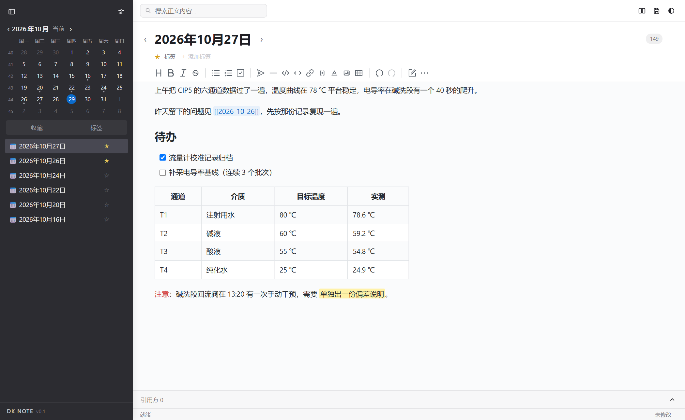
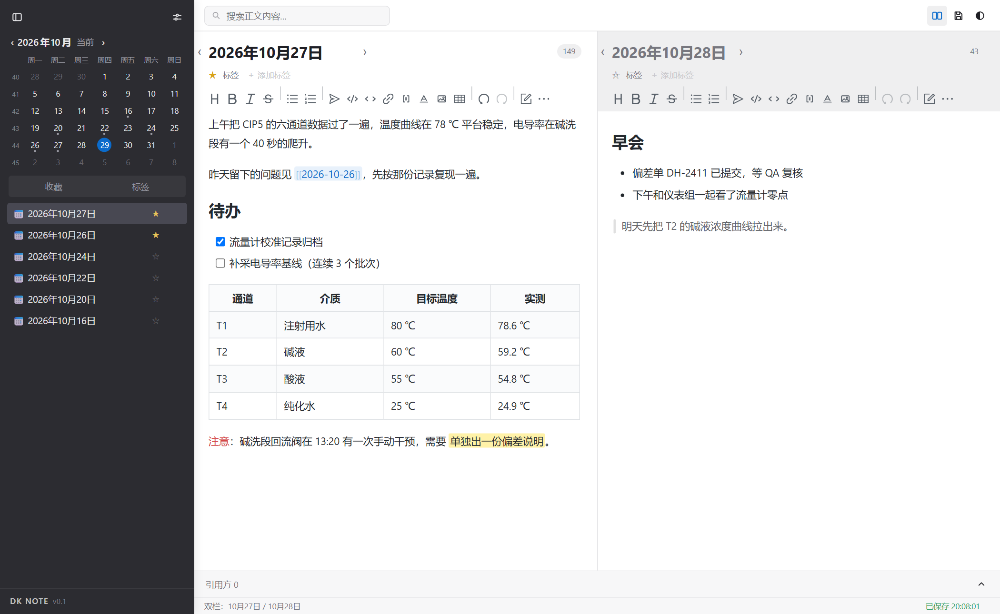
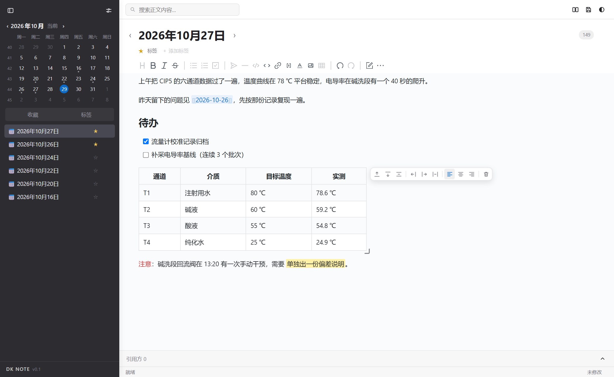
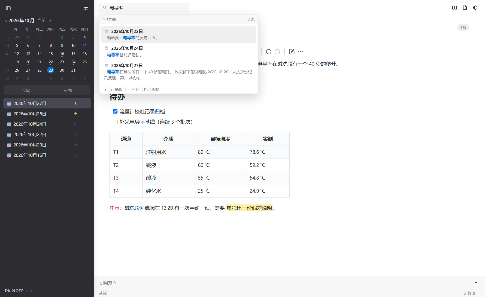
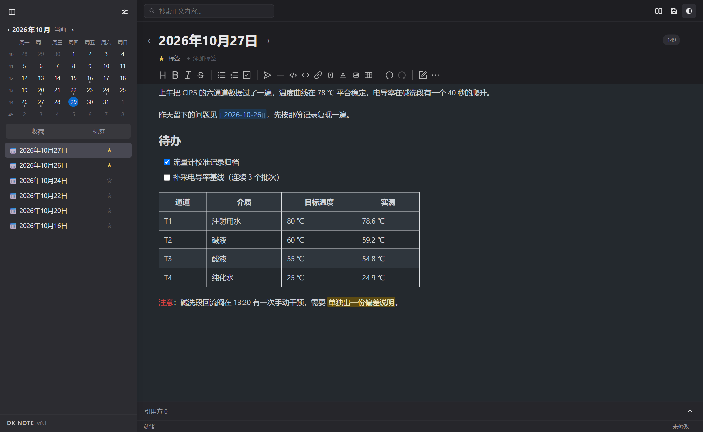

# DK NOTE

日志型的本地 Markdown 笔记应用。左侧日历选日期，右侧直接写，一天一篇，笔记就是磁盘上的 `.md` 文件。

纯静态单页，没有后端、没有账号、没有网络请求。打开即用，数据留在浏览器里，也可以绑定本地文件夹直接读写真实的 `.md`。



在线试用：<https://dreamke.github.io/DK-NOTE/>

## 为什么是「日志型」

多数笔记工具先有「笔记」，再按时间排序。DK NOTE 反过来：**日期是唯一的组织单位**。

- 点日历上的任意一天就开始写，不需要新建、起标题、选文件夹
- 日志标题就是日期，不可改名——省掉归档时最耗神的那个动作
- 有内容的日子在日历上标一个小圆点，一眼看出哪几天断更
- 侧栏按日期倒序列出全部日志，收藏的可以单独筛出来



## 功能

### 写作

| 能力 | 说明 |
| --- | --- |
| 即时渲染 | 基于 Vditor 的 IR 模式，Markdown 与排版同屏，光标移开标记自动收合 |
| 常用格式 | 标题、加粗、斜体、删除线、引用、有序/无序/任务列表、代码块、分割线、链接、公式 |
| 字色与高亮 | 6 档字色 + 6 档高亮，格式与旧版一致，反解成标准内联 HTML，不污染正文 |
| 图片 | 粘贴或拖入即插入，自动压缩到 1600px 以内并转 WebP；`.md` 里存 data URI，编辑器内部换 blob 短链保证输入不卡 |
| 双链 | 输入 `[[` 或点工具栏插入，按标题跳转；指向不存在的笔记时提示新建 |
| 双栏 | 左右各开一天，同时编辑连续两天（`Ctrl+Shift+D`） |

### 表格



- 自绘工具条：上/下加行、删行、左/右加列、删列、左中右对齐、删除整表
- 拖列边界改列宽、拖行边界改行高，双击复位
- 整表宽度拖右下角手柄调整，双击回到默认（正文宽度的一半）
- 窄窗格里单元格自动换行，不会出现横向滚动条

### 查找与整理



- 全文搜索正文，空格分词、多个关键词同时命中才出现结果；结果挂在搜索框下方，`↑↓` 选择、`↵` 打开、`Esc` 关闭
- 收藏星标：标题下方的 ☆，收藏后在侧栏「收藏」页单独查看
- 标签：正文写 `#标签` 自动识别，也可以点「＋ 添加标签」；侧栏「标签」页列出标签池与篇数

### 外观



明暗两套主题，深灰侧栏配白色编辑区，日历带 ISO 周数、周一为一周起始。

## 数据放在哪

| 方式 | 说明 |
| --- | --- |
| 浏览器存储 | 默认写 IndexedDB，不可用时退回 localStorage，再退回内存（会提示） |
| 绑定本地文件夹 | 用 File System Access 直接读写一个真实目录里的 `.md`，文件归你，随时可以用别的工具打开 |
| 导入 / 导出 | 设置里可以整库打包成 zip，也可以导入零散的 `.md` |

没有埋点、没有远端接口，正文不会离开这台机器——除非你把绑定的文件夹放进了自己的同步盘。

> WebDAV 同步的代码在，但当前版本没有放出入口（设置里那段是关闭状态）。多设备请用导出 zip 手动搬，或把绑定的文件夹放进你自己的同步盘。

## 本地运行

```bash
git clone https://github.com/dreamke/DK-NOTE.git
cd DK-NOTE
node dev-server.js        # http://127.0.0.1:8787/
```

`dev-server.js` 只是个静态文件服务，任何 HTTP 服务器都行（`python -m http.server` 也可以）。

不建议直接双击 `index.html` 用 `file://` 打开：编辑器内核按相对路径同步加载语言包与图标，部分浏览器会以跨域策略拦截。

首次打开会停在「正在加载编辑器」一步——编辑器内核（lute）未压缩约 3.6 MB，本地服务瞬间完成，网络托管则取决于带宽。加载完浏览器会缓存，之后打开明显更快。

## 技术实现

单个 `index.html`（约 4800 行）承载全部界面与逻辑，样式、脚本内联，Vditor 与图标精灵本地内置，运行时零外部请求。

| 部分 | 做法 |
| --- | --- |
| 编辑器 | Vditor 固定 IR 模式；双栏时右栏克隆左栏 DOM（`id` 统一加 `-b`），改一处两栏同步 |
| Markdown | 读写走 `mdForEditor` / `mdForStore` 两个兑换口，只在边界上处理图片载荷 |
| 双链 | 存的就是 `[[标题]]` 纯文本，渲染时后置包一层 chip，`textContent` 一个字都不改——否则反解 Markdown 会丢括号 |
| 字色 / 高亮 | Lute 把内联 HTML 收进 `span[data-type="html-inline"]`，再在标记之间套纯样式元素上色，两层分离 |
| 表格尺寸 | Markdown 表达不了列宽行高，尺寸存在浏览器本地的 `tblsize:<笔记名>`，`.md` 一个字节都不动 |
| 存储 | IndexedDB → localStorage → 内存 三级降级，接口统一为 `Store` |

## 已知限制

- **表格尺寸不跟着文件走**：列宽、行高、整表宽度只存在本机，换设备或清缓存会回到默认。这是为了保持 `.md` 是干净的标准表格，能被任何 Markdown 工具读取。
- **数据不跨设备**：没有账号体系，浏览器之间不共享。要同步请用 WebDAV 或导出 zip 手动搬。
- **WebDAV 受跨域限制**：服务端必须返回 `Access-Control-Allow-Origin`，否则浏览器会拦下请求。桌面端壳（Electron / Tauri）不受此限。
- **绑定本地文件夹需要安全上下文**：`https` 或 `localhost` 可用，`file://` 不可用。
- **只适合日志**：没有笔记本、层级目录、多标签页；也不支持修改日志文件名。

## 目录结构

```
DK-NOTE/
├── index.html              主程序（样式 + 逻辑内联）
├── dev-server.js           本地预览用的静态服务
├── assets/                 图标与截图
├── vditor/dist/            编辑器内核（本地内置）
└── archive/index.html      早期自研编辑器版本，留档
```

## 许可

MIT。编辑器内核 [Vditor](https://github.com/Vanessa219/vditor) 同样以 MIT 发布，其许可证见 `vditor/LICENSE`。
